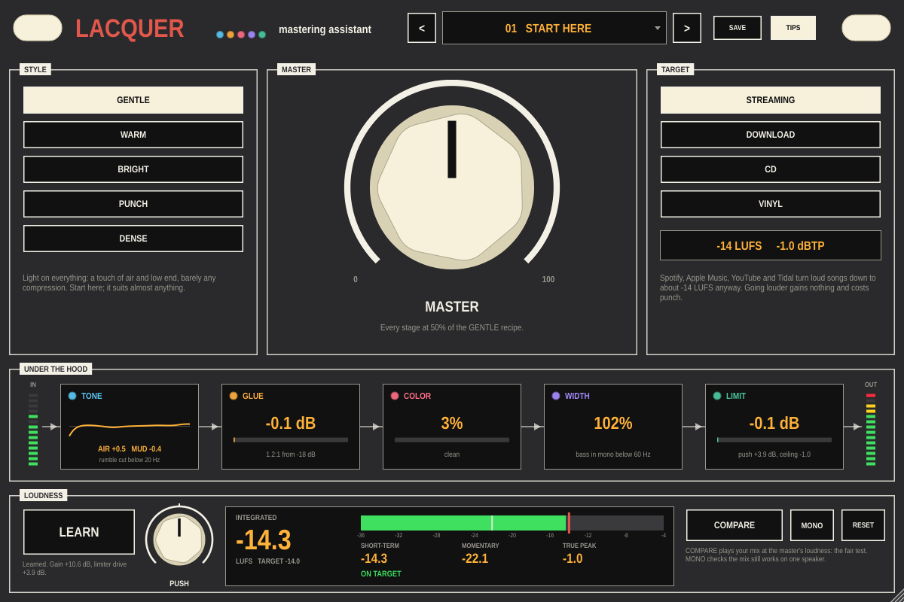

# Lacquer

A mastering assistant for Ableton Live. Pick a STYLE, pick where the song is
going (streaming, download, CD or vinyl), press LEARN and play the song.
Lacquer sets the loudness so the master lands on the target without peaks
going over, and the one MASTER knob decides how much shaping goes on
alongside: EQ, compression, saturation and stereo width, all moved together.

It's also meant to teach. The UNDER THE HOOD strip shows what each of the
five stages is doing to your track while it plays, and clicking a stage
switches it off so you can hear what it was adding. COMPARE plays your
original mix at the same loudness as the master, which is the only fair
way to judge it.

Put it last on the master channel, or on the track of a mix you've
exported and brought into a new set.



New to mastering? The [guide](docs/Lacquer-Guide.pdf) (PDF) starts from
nothing: what mastering is, what LUFS and true peak mean, how to set up a
mastering session in Live, a tour of the panel, and how to export files for
distribution.

## What's on the panel

**Header**: PRESET (click for the list, or step with `<` `>`; a `*` means
you've changed it), SAVE, TIPS.

**STYLE** is the character of the master:
- **GENTLE**: a touch of air and low end, barely any compression. Suits almost anything.
- **WARM**: more low end, a softer top, tape-like saturation.
- **BRIGHT**: clears the low mids, lifts presence and air, slightly wider.
- **PUNCH**: firmer low end; a compressor slow enough to let drum hits through.
- **DENSE**: faster compression and more saturation; everything pushed together.

**MASTER** sets how much of the style to apply, to every stage at once.
At 0 nothing is shaped and only the loudness is set.

**TARGET** sets the loudness and the true-peak ceiling:

| Target    | Loudness  | Ceiling   | Notes |
|-----------|-----------|-----------|-------|
| STREAMING | -14 LUFS  | -1.0 dBTP | Spotify, YouTube, Tidal, Amazon normalise to about -14 |
| DOWNLOAD  | -11 LUFS  | -1.0 dBTP | Bandcamp and files nobody turns down for you |
| CD        | -10 LUFS  | -0.3 dBTP | No lossy encoding afterwards, so the ceiling can sit higher |
| VINYL     | -13 LUFS  | -1.0 dBTP | Bass in mono below 150 Hz; the cutting engineer sets the final level |

**UNDER THE HOOD**: the five stages in signal order, each showing what it's
doing now. Click one to switch it off.
- **TONE**: a high-pass at 20 Hz, then a low shelf (90 Hz), a cut or boost
  in the low mids (250 Hz), presence (3.2 kHz) and an air shelf (10 kHz).
  Never more than 2.5 dB anywhere. The curve is drawn in the block.
- **GLUE**: a stereo-linked compressor with a soft knee. The detector
  ignores the deep bass. Ratio up to 3:1; attack and release depend on the
  style. Shows the gain reduction now.
- **COLOR**: soft saturation. Shows how much it rounds the peaks.
- **WIDTH**: mid/side. Widens the sides by up to 12% and puts the bass in
  mono below a crossover (fixed at 150 Hz for VINYL).
- **LIMIT**: true-peak lookahead limiter with 4x oversampled detection. It
  turns the master up to the target and keeps every peak under the ceiling.
  Switching it off also removes that boost, so you'll hear it get quieter.

**LOUDNESS**
- **LEARN**: press it and play the song (all of it is best). Lacquer
  measures the song and sets two levels: the gain into the stages, so they
  always see a predictable level, and the drive into the limiter, so the
  output lands on the target. It stops by itself when the song ends, or
  press it again. What it learned is saved with the set, and changing
  TARGET afterwards moves the level with it. LEARN again if you change
  STYLE or MASTER a lot.
- **PUSH**: louder or quieter than the target, up to 6 dB each way.
- The display: **INTEGRATED** loudness (the whole song since you pressed
  play), a **SHORT-TERM** bar (3 seconds) with the target marked in red,
  **MOMENTARY** (0.4 s) and **TRUE PEAK** (red if it ever went over the
  ceiling). Measured to ITU-R BS.1770-4 / EBU R128, the same way streaming
  services measure.
- **COMPARE**: plays the original mix, delayed to line up and turned to
  match the master's loudness.
- **MONO**: listen in mono.
- **RESET**: restart the integrated reading and the true-peak hold. They
  also reset whenever you press play in Live.

Everything except LEARN and RESET is a host parameter. Lacquer reports its
latency (about 2 ms) to Live, which compensates for it.

**Presets**: 14 factory presets, each a STYLE, TARGET and MASTER for a kind
of music. A preset doesn't include what LEARN found, so you can try several
on the same song. SAVE writes your own to
`~/Library/Application Support/Lacquer/Presets` (Windows `%APPDATA%\Lacquer\Presets`,
Linux `~/.config/Lacquer/Presets`).

## Building

Needs CMake 3.22+ and a C++20 compiler. JUCE 8.0.9 is downloaded on first
configure.

```sh
cmake -B build -DCMAKE_BUILD_TYPE=Release
cmake --build build --config Release
ctest --test-dir build -C Release
```

The VST3 is copied to `~/Library/Audio/Plug-Ins/VST3` after each build on macOS
(`-DLACQUER_COPY_PLUGIN=OFF` to stop that). `-DLACQUER_BUILD_TOOLS=ON` also
builds `LacquerSnapshot`, which runs Lacquer without a host and writes the
panel to a PNG. Given a WAV, it also masters it: one LEARN pass, then a
render, with the loudness before and after.
`LacquerSnapshot panel.png in.wav out.wav [style target master]`.

The engine tests check the loudness meter against the BS.1770 reference
tone, the gate and the true-peak reading. They check that every style,
target and MASTER setting stays under its ceiling at 44.1, 48 and 96 kHz,
that LEARN lands within 1 LU of every target on both a quiet and a hot mix,
that MASTER at 0 leaves the level alone, the latency, COMPARE's level match
and MONO.

The [Build workflow](.github/workflows/build.yml) builds and tests on macOS,
Windows and Linux when you run it from the Actions tab. Run it on a version tag
(`v0.1.0`) to get a draft release with all three archives attached.

## Licence

Lacquer is released under the GNU AGPLv3. See [LICENSE](LICENSE).
